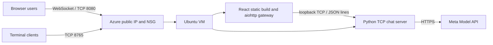

# Deploy Chunky chat on an Azure VM

An Ubuntu VM is the simplest Azure host for this assignment because it can accept both browser traffic on TCP port 8080 and direct TCP chat clients on port 8765. The React build is served by `web_app.py`; each browser WebSocket is bridged to the Python TCP chat server. A single VM keeps all users and room state in the same process.

## 1. Create the VM

In [Azure portal](https://portal.azure.com/), create a resource group and a **Virtual machine** with Ubuntu Server 24.04 LTS, a public IPv4 address, SSH public-key authentication, and an administrator username such as `azureuser`. Save the downloaded SSH private key outside this repository. Choose a VM size with at least 1 GiB of RAM for the demo and review the displayed monthly cost before creating it.

On the VM's **Networking** page, add inbound network security group rules for **TCP 8080** (browser) and **TCP 8765** (raw chat clients). Allow **TCP 22** for SSH from your own IP address. These are public demo ports; the app currently uses plaintext HTTP, WebSocket, and TCP.

## 2. Build and upload the app

In PowerShell on this computer, replace the IP and key path with yours:

```powershell
Set-Location 'C:\Users\Aaron\Downloads\New folder (6)'
npm --prefix frontend ci
npm --prefix frontend run build
$vmIp = 'YOUR_VM_PUBLIC_IP'
$sshKey = 'C:\path\to\your-azure-key.pem'
ssh -i $sshKey "azureuser@$vmIp" 'mkdir -p ~/tcp-chat/frontend'
scp -i $sshKey chat_server.py web_app.py deploy_azure_vm.sh "azureuser@${vmIp}:~/tcp-chat/"
scp -i $sshKey -r frontend/dist "azureuser@${vmIp}:~/tcp-chat/frontend/"
```

If your VM username differs from `azureuser`, replace it in every command.

## 3. Start the service

Connect to the VM and run the setup script:

```powershell
ssh -i $sshKey "azureuser@$vmIp"
```

```sh
bash ~/tcp-chat/deploy_azure_vm.sh
curl http://127.0.0.1:8080/healthz
```

The setup script installs Python and `aiohttp`, creates a `systemd` unit, and enables the chat service after reboot. If it fails, inspect `sudo journalctl -u tcp-chat -n 100 --no-pager`.

## 4. Configure Chunky privately

On the VM, create a root-owned environment file. In `nano`, add a single `MODEL_API_KEY=...` line using your current Meta key. Do not upload that key with the source files or commit it.

```sh
sudo install -m 600 -o root -g root /dev/null /etc/tcp-chat.env
sudo nano /etc/tcp-chat.env
sudo systemctl restart tcp-chat
```

## 5. Verify from two locations

Open `http://YOUR_VM_PUBLIC_IP:8080` in two browser windows or on two devices. Join with different nicknames and send messages in the same room. From this computer, `python smoke_remote.py YOUR_VM_PUBLIC_IP` verifies that two TCP clients can communicate and writes `evidence/remote-demo.json` on success. The raw client can also connect with `python chat_client.py alice --host YOUR_VM_PUBLIC_IP`.

Architecture:



This is a single-VM assignment deployment. Chat and room state are in memory. For use beyond a demo, add HTTPS/WSS and TLS for raw TCP, user authentication, AI usage controls, and persistent message storage.
